<p align="center">
  
</p>

<p align="center">
  <a href="https://www.linkedin.com/in/luca-gobbi-dev/"></a>
  <a href="mailto:luca.gobbi2@gmail.com"></a>
  
</p>

> **Currently building:** a cloud-agnostic access-control platform<br>
> <sub>Kubernetes · Event-Driven Architecture · OpenTelemetry Metrics · LLM Embedding &amp; Inference</sub>

## > whoami

```console
luca@crovax:~$ whoami
> Software Architect
luca@crovax:~$ cat focus.md
> cloud-agnostic · event-driven · OTEL
> LLM embedding & inference
luca@crovax:~$ ls ./now
> access-control/  ai-agents/
luca@crovax:~$ _
```

## > engineering_focus

I design and modernize software for environments where reliability, traceability and operational clarity matter. My experience spans focused products, business platforms, enterprise SaaS and real-time systems at national scale — from domain modelling and API design to Kubernetes, observability, delivery workflows and technical leadership. I have led modernization from legacy monoliths to hexagonal microservices and built high-throughput traffic and sensor pipelines.

- **Cloud-agnostic by default.** Kubernetes, GitOps and portable platform primitives. AWS and Azure are deployment targets, not the architecture.
- **Event-driven at the core.** Kafka, gRPC, asynchronous workflows, schema evolution and hexagonal boundaries.
- **Observable and operable.** OpenTelemetry metrics, traces and logs, SLOs, CI/CD and production feedback loops.
- **Applied AI, locally when needed.** Embeddings, RAG and inference pipelines; local LLMs for private or sensitive workloads.

> Practices: Agile/Scrum · Hexagonal Architecture · Event-Driven Design · GitOps · Specification-Driven Development · Security by Design · YAGNI
>
> I prefer the smallest design that solves the current problem; simplicity is not an excuse to skip security, observability or operational readiness.

## > stack

| Pillar | What it covers |
| --- | --- |
| **Kubernetes** | Portable orchestration, Helm, GitOps, workload isolation. |
| **Event-Driven Architecture** | Kafka, gRPC, asynchronous workflows, schema evolution. |
| **OTEL Metrics Gathering** | Metrics, traces, logs, SLOs, vendor-neutral telemetry. |
| **LLM Embedding & Inference** | RAG, pgvector, local inference, agentic workflows. |

<details>
<summary><b>Full stack</b></summary>

- **Languages & frameworks:** Java 21, Spring Boot, Spring Cloud, gRPC, Python, TypeScript, React, Angular, Rust, C++
- **Platform & delivery:** Kubernetes, Docker, Helm, Terraform, Argo CD, Jenkins, GitLab CI, GitHub Actions
- **Data & streaming:** Kafka, Kafka Streams, Avro, PostgreSQL, pgvector, Redis, MongoDB, Oracle, SQL Server, MariaDB, DB2, SQLite
- **Observability:** OpenTelemetry, CloudWatch
- **AI:** MCP, OpenSpec, Ollama, llama.cpp, RAG, pgvector
- **Cloud targets:** AWS, Azure

</details>

## > featured_projects

| Project | Stack |
| --- | --- |
| **draiver-flow** 🔒<br><sub>Private enterprise-style media & knowledge platform: Java 21/Spring Boot backend, hexagonal architecture, React/Vite frontend, PostgreSQL/pgvector retrieval, internal LLM tagging, asynchronous jobs and OpenTelemetry.</sub> | `Java 21` · `Spring Boot` · `pgvector` · `React` · `OTEL` |
| **[draiver-resume-cli](https://github.com/Crovax1990/draiver-resume-cli)**<br><sub>Resume-as-code pipeline: multilingual PDFs from JSON Resume, headless rendering, local/provider LLM translation.</sub> | `Python` · `LLM translation` · `Make` |
| **[dichiaro](https://github.com/Crovax1990/dichiaro)**<br><sub>Interactive tax dashboard: structured PDF extraction, multi-year analysis, deduction projections and anomaly detection.</sub> | `Python` · `Streamlit` · `Plotly` · `SQLite` |

## > telemetry

<p align="center">
  
</p>

<p align="center">
  <picture>
    <source media="(prefers-color-scheme: dark)" srcset="https://raw.githubusercontent.com/Crovax1990/Crovax1990/output/github-contribution-grid-snake-matrix-dark.svg" />
    <source media="(prefers-color-scheme: light)" srcset="https://raw.githubusercontent.com/Crovax1990/Crovax1990/output/github-contribution-grid-snake-matrix-light.svg" />
    
  </picture>
</p>

## > connect

Interested in open-source collaboration around Spring, distributed systems, platform engineering and agentic workflows.

- [LinkedIn](https://www.linkedin.com/in/luca-gobbi-dev/)
- [Email](mailto:luca.gobbi2@gmail.com)

## > interests

- Linux and open-source ecosystems
- Local LLM inference, RAG and AI in healthcare
- Cycling and outdoor activities
- Gaming: World of Warcraft, League of Legends, Factorio, Minecraft

> *There is no spoon. Only deploys.*
>
> “Crovax” comes from *Crovax the Cursed* in Magic: The Gathering.
